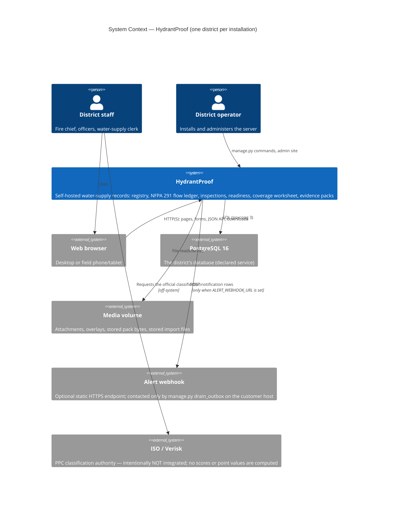
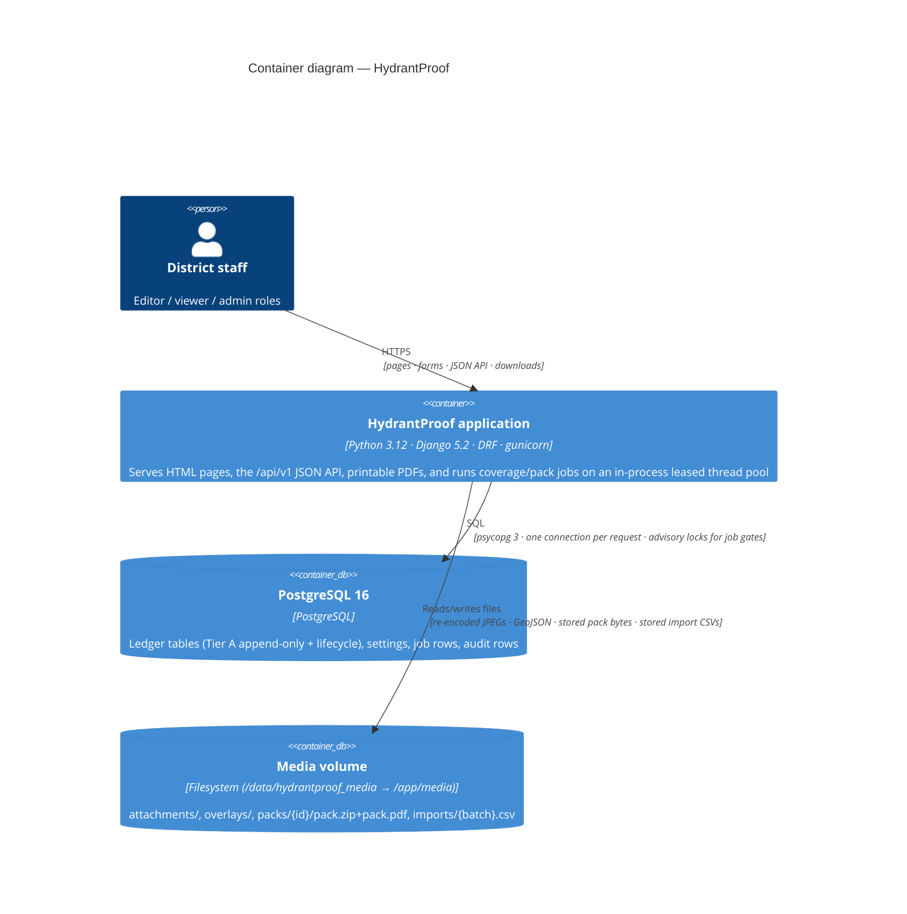
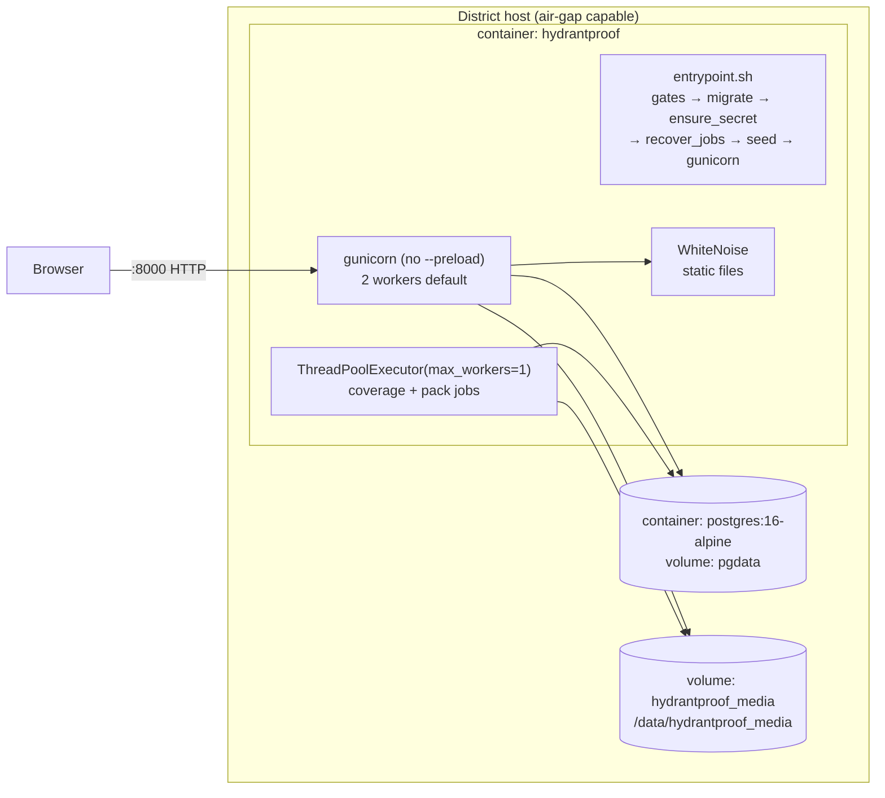
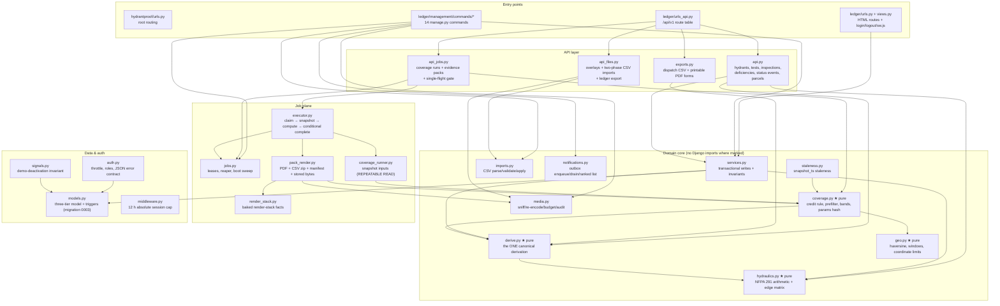
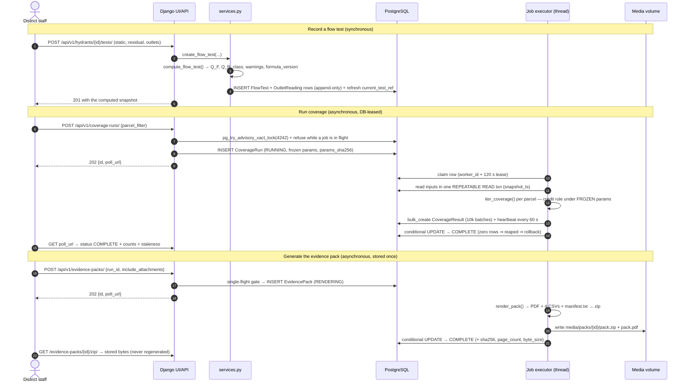
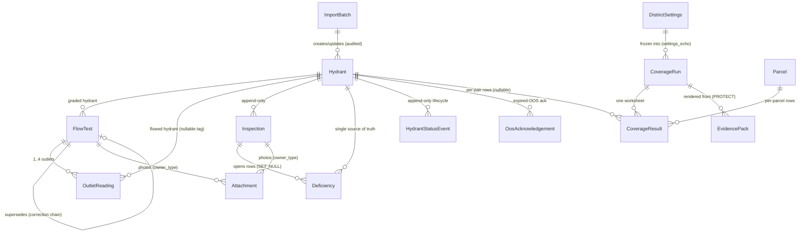

# HydrantProof — Architecture

**Audience:** engineers who need to understand how the system fits together,
change it safely, or debug it in production. For installing and running the
system see [`OPERATIONS.md`](OPERATIONS.md); for the HTTP contract see
[`API.md`](API.md).

---

## 1. Project shape

HydrantProof is a **self-hosted Django web application** — a hybrid of four
surfaces served by one process:

| Surface | What it is |
|---|---|
| Server-rendered UI | Django templates at `/`, `/dashboard/`, `/hydrants/`, `/hydrants/{id}/`, `/coverage/`, `/packs/`, `/field/`, `/login/` |
| JSON API | Django REST Framework at `/api/v1/…` (39 paths), plus the anonymous OpenAPI schema at `/openapi.json` |
| Asynchronous jobs | Coverage runs and evidence-pack renders, executed on an in-process `ThreadPoolExecutor(max_workers=1)` under a database lease |
| Management CLI | `manage.py` commands for accounts, seeding, imports/exports, notifications, pruning, and recovery |

There is **no frontend build step, no Redis, no Celery, no Node, and no
PostGIS**. One Python process (gunicorn, 2 workers by default) plus PostgreSQL
serves everything; static assets are collected at image build time and served
by WhiteNoise.

The screen inventory with per-screen purpose, the user-flow diagrams, and the
UI component (template) hierarchy live in [`UI.md`](UI.md); because there is
no build step, the UI's component model *is* the template tree plus the two
page scripts.

---

## 2. C4 Context diagram

Who and what surrounds the system. Note what is deliberately *not* connected:
there is no ISO/Verisk integration (no points are computed), and the server
makes no outbound HTTP calls except the customer-hosted `drain_outbox`
command.

---

## 3. C4 Container diagram

One application container, one database, one persistent volume. The job
executor lives *inside* the web process (there is no separate worker
container) — this is the deliberate "the row is the queue" design.

### Runtime topology (Docker)

---

## 4. Component (module) diagram

The `ledger` Django app is the whole product. Modules, with their actual
responsibilities:

★ = pure Python modules, unit-tested without a database.

---

## 5. Primary flow — record a test, run coverage, ship a pack

One sequence covering the two asynchronous jobs and the derivation that every
surface shares.

---

## 6. Data model

Three tiers with different mutation rules, enforced in three places (ORM,
routes, and — for Tier A — database triggers):

* **Tier A — append-only truth tables (8).** `FlowTest`, `OutletReading`,
  `HydrantStatusEvent`, `HydrantAttributeChange`, `ParcelAttributeChange`,
  `Inspection`, `OosAcknowledgement`, `SettingsAudit`. A PostgreSQL
  `BEFORE UPDATE OR DELETE` trigger (migration `0003_tier_a_triggers`) refuses
  mutation; the ORM `AppendOnlyModel.save()/delete()` raises too. Corrections
  are new rows (supersession, reversal, acknowledgement).
* **Tier B — lifecycle tables.** `Deficiency`, `Attachment`, `Parcel`,
  `CoverageRun`, `CoverageResult`, `EvidencePack`, `MapOverlay`,
  `ImportBatch`, `NotificationOutbox`, `AppSetting`, `LoginAttempt`,
  `ExportAudit`, `MediaAudit`. No DB trigger; only the enumerated route
  mutations exist, and they are tested.
* **Tier C — mutable core.** `Hydrant`, `DistrictSettings`, users.

Key column truths worth knowing before you query:

* `Hydrant.current_test_ref` is a denormalized pointer to the current test —
  **max `(tested_on, created_at, id)` among non-superseded tests** — maintained
  under a row lock in `services.refresh_current_test_ref`.
* `CoverageRun.params_sha256` = SHA-256 of the canonical
  `{constants, settings, parcel_filter}` JSON; `core_params_sha256` is the same
  payload with `parcel_filter: null` (the live staleness comparison key).
  `snapshot_ts` anchors staleness to the run's `REPEATABLE READ` transaction.
* `CoverageResult.distance_ft` is **unrounded**; display rounds to 0.1 ft.
* `EvidencePack` stores `pdf_sha256` / `csv_zip_sha256` and the file paths
  under `media/packs/{id}/`.
* `Attachment.sha256`/`byte_size` describe the **stored** (re-encoded) bytes;
  `original_content_type` is the sniffed upload type; `capture_meta` keeps the
  pre-strip EXIF facts.
* `NotificationOutbox` is unique on `(hydrant, kind, as_of_date)` — the
  idempotency key for nightly enqueueing.

---

## 7. Key design decisions (and why)

1. **One canonical derivation.** Every surface — list badges, dispatch CSV,
   worksheet, pack, trend — reads `derive.derive_hydrant()` and nothing else
   (`ledger/derive.py`). A readiness rule can never drift between two views.
2. **Compute once, at write time.** `hydraulics.compute_flow_test()` runs when
   the test is saved; the result (`Q_F`, `Q_R`, class, warnings,
   `formula_version`) is stored. Nothing recomputes lazily, so a historical
   pack is reproducible from stored rows.
3. **The row is the queue.** Coverage/pack jobs are database rows with a
   worker id and a 120-second lease, heartbeated every 60 seconds; the reaper
   keys on **expired lease**, never wall-clock age. A reaped job's late writes
   are discarded by a conditional final `UPDATE … WHERE worker_id = me`
   (`executor.py`). Single-flight rests on a PostgreSQL advisory lock
   (`pg_try_advisory_xact_lock(4242)`) plus the row state — never on the pool.
4. **Pack bytes are stored, never regenerated.** A download serves exactly the
   bytes rendered once; a pruned pack is 404, a missing file 410.
5. **Append-only truth with database triggers.** Integrity rules live in the
   database (Tier A triggers) *and* the ORM *and* the route table — three
   layers, because the audit trail is the product.
6. **Offline-first by contract.** The container performs no runtime outbound
   HTTP except the customer-hosted `drain_outbox`; map tiles are fetched by
   the **browser** (`MAP_TILE_URL`, default empty), Leaflet is vendored, PDFs
   are drawn with ReportLab base-14 fonts only, and static assets are served
   by WhiteNoise with no CDN.
7. **Two auth surfaces, one throttle.** Session auth for pages, HTTP Basic
   scoped to `/api/v1/` (CSRF-exempt by construction). Three login surfaces
   (form, Basic 401, admin) write `LoginAttempt` rows; the throttle accepts
   valid credentials up to a per-username cap during a window rather than
   locking out, closing the classic lockout-DoS without opening a hash-CPU
   DoS (bounded by a process-wide semaphore of 2, 5 s timeout).
8. **Refusal gates, not warnings.** The entrypoint refuses to boot an insecure
   posture (`ALLOWED_HOSTS=*` or `COOKIE_SECURE=false`) once demo seeding is
   off or real rows exist, unless the operator explicitly waives with
   `ALLOW_INSECURE_LOOPBACK=true` for an air-gapped loopback instance.
9. **Demo data cannot survive real data.** A `post_save` signal deactivates
   all demo accounts in the same transaction as the first non-sample row.
10. **Provisional constants are labeled, not hidden.** Grounded arithmetic
    (29.83, 20 psi, 0.54 exponent) is separated from provisional,
    verification-gated policy (extrapolation factor, trend threshold, bands)
    in `constants.py`; every PDF footer and manifest repeats the banner.
11. **Coverage determinism.** A conservative latitude-bisect prefilter plus an
    exact haversine on survivors; inclusion compares the **unrounded** distance
    against the radius, so a 999.5 ft pair is in and a 1000.5 ft pair is out,
    identically on every run.
12. **CSV-injection neutralization** applies to text-typed cells in every CSV
    export (`csvio.neutralize_cell`): a leading `=`, `+`, `-`, `@`, tab or CR
    is prefixed with a quote.
13. **One media budget, one attachment sub-budget.** Enforced at every write
    path (upload pre-flight, pack pre-flight, prune backstop) against the
    `DistrictSettings` limits.

---

## 8. Deployment / runtime model

**Declared services** (`runtime-services.json`): a PostgreSQL 16 service
(`db`) and one persistent storage mount `hydrantproof_media` at
`/data/hydrantproof_media`, linked to the application's fixed media path
(`/app/media`). The container image is single-stage, base-pinned by digest,
and runs as a non-root `app` user when started as root.

**Boot order** (`entrypoint.sh`, fixed and idempotent):

1. `manage.py check_posture --static` — static refusal gates (no DB needed).
2. Database wait — up to 150 s (30 × 5 s), then a fatal exit.
3. `manage.py migrate --noinput`.
4. `manage.py ensure_secret` — resolves the secret key; exports it for the
   process if only the DB-persisted key exists (demo posture, logged).
5. `manage.py check_posture` — the data-bearing gate (refuses on a non-sample
   ledger in an insecure posture, and refuses to serve with the public
   build-time secret key).
6. `manage.py recover_jobs` — every RUNNING/RENDERING row becomes
   `FAILED (orphaned)`; partial rows and files are cleaned. No phantom jobs
   survive a restart.
7. `collectstatic` if the manifest is absent (image builds collect it earlier).
8. `manage.py seed_demo` when `SEED_DEMO=true` (idempotent; refuses if the
   ledger is not empty or the purge marker is set).
9. **Media ownership hand-off** — when the entrypoint runs as root, it creates
   the media root (`HYDRANTPROOF_MEDIA_ROOT`, default `/app/media` — the
   container's `MEDIA_ROOT`, which Django derives from `<repo>/media` where
   `<repo>` is `/app`) and `chown -R app:app`'d it, so the unprivileged
   workers can write packs, attachments, overlays and stored import files. A
   fresh named volume is also pre-owned because the image ships `/app/media`
   owned by `app`.
10. `gunicorn hydrantproof.wsgi:application` — **without `--preload`** so the
    lazily-constructed job executor can never be forked into a broken pool.

**Scaling envelope.** The spec's target is a district-scale ledger (the scale
test group documents the timing envelope). The list endpoint pages at the
database and derives only the 50-row page; derived-field filters
(`readiness`/`class`/`recency`) evaluate every row on demand and are the known
worst case. Jobs are single-flight by design.

---

## 9. Security posture (as built)

* Roles: `admin` / `editor` / `viewer` groups; superusers count as admin.
  Route-level permissions are `CanWrite` (editor+) and `IsAdmin`.
* Anonymous surface is exactly enumerated and test-pinned:
  `/healthz`, `/login/`, `/logout/`, `/admin/login/`, `/sw.js`,
  `/openapi.json`, and `/static/…`.
* Coordinates are validated to |lat| ≤ 80, |lon| ≤ 180; overlay GeoJSON is
  geometry-allow-listed and coordinate-checked; attachment uploads are
  content-sniffed (extension ignored), size-capped, re-encoded with EXIF
  stripped, and served with `X-Content-Type-Options: nosniff`.
* Sessions: 2 h idle + 12 h absolute; cookies can be marked `Secure` via
  `COOKIE_SECURE`; CSRF is enforced on all unsafe HTML methods.
* The ledger export (`/api/v1/exports/ledger/`) is **admin-only** because it
  carries password hashes for restore; it excludes `AppSetting` (the
  DB-persisted secret key never leaves in a JSON backup).
* Throttling covers the login form, HTTP Basic 401s, and the Django admin
  login; `TRUST_PROXY_HEADERS=true` (only behind a header-stripping proxy)
  activates the per-IP dimension.
* Known limits are stated, not hidden: field capture is proof of records, not
  proof of presence; the pack manifest is self-attested, not cryptographically
  signed; the v0 file sandbox is the container itself.
