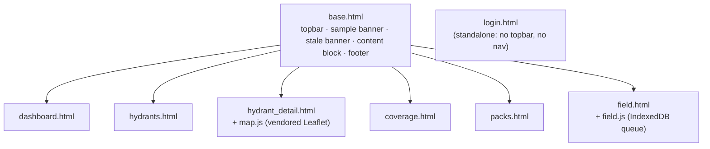
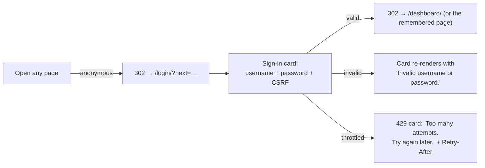
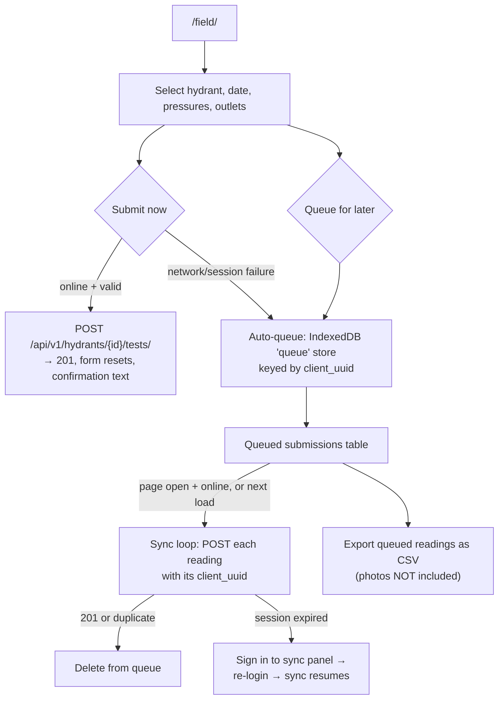
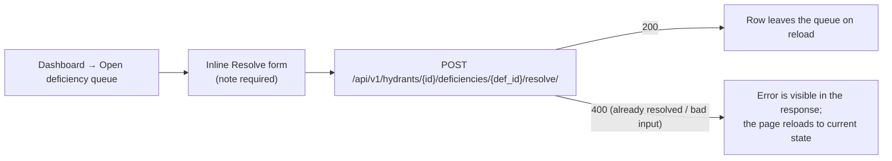

# HydrantProof — UI Reference

**Audience:** designers, operators, frontend maintainers, and reviewers.
HydrantProof's UI is server-rendered Django templates — **no frontend build
step, no framework, no bundler**. One stylesheet, two small page scripts, and
a vendored Leaflet distribution.

Everything in this document is implemented in:

* `ledger/templates/ledger/` — 19 templates: the page set (`base`, `login`,
  `dashboard`, `hydrants`, `hydrant_form`, `hydrant_detail`, `flow_test_form`,
  `inspection_form`, `parcels`, `parcel_form`, `parcel_detail`, `coverage`,
  `packs`, `exports`, `settings`, `guide`, `field`) plus the shared partials
  `_mark.html` and `_icon.html`
* `ledger/static/ledger/tokens.css` — the closed token layer (every colour,
  size, duration and z-index; see §5) and `app.css` — the one stylesheet built
  from it
* `ledger/static/ledger/*.js` — the page scripts: `field.js` (the `/field/`
  capture PWA), `map.js` (hydrant-detail map), `pinmap.js` (pin-drop on the
  hydrant/parcel forms), `flowtest.js`, `inspection.js`, `hydrantform.js`,
  `parcelform.js`, `statusform.js`, `coverage.js`, `packs.js`, `app.js`,
  `preview-bootstrap.js`
* `ledger/static/vendor/leaflet/` — vendored Leaflet **1.9.3** (the dist's own
  header says 1.9.3; the spec asked for 1.9.4 and no reachable package vendors
  it — the deviation is documented in
  `ledger/static/vendor/leaflet/VENDOR.md`)
* `ledger/views.py`, `ledger/pages.py` — page routes and context builders

`DESIGN.md` is the written design system; `tokens.css` is its enforced
machine-readable half — a raw hex, px length or duration outside that file is
a defect (pinned by `tests/test_ui_system.py`).

---

## 1. Screen inventory

| # | Route | Template | Auth | Purpose |
|---|---|---|---|---|
| 1 | `/login/` | `login.html` | anonymous | Sign-in card (CSRF-protected form) |
| 2 | `/dashboard/` (and `/`) | `dashboard.html` | session | District readiness cockpit: KPI panels, expired OOS queue, ranked overdue tests/inspections, degrading flow, open deficiency queue |
| 3 | `/hydrants/` | `hydrants.html` | session | Registry list: every hydrant with status, readiness badge, class, trend, recency flags, last test, rated flow |
| 4 | `/hydrants/{id}/` | `hydrant_detail.html` | session | One hydrant: derivation summary, attributes, Leaflet map, flow tests, inspections, deficiencies, status history, attribute history |
| 5 | `/coverage/` | `coverage.html` | session | Water-supply worksheet: run button + poll, latest complete run summary (frozen parameters, counts, distribution bands), run history, staleness banner |
| 6 | `/packs/` | `packs.html` | session | Evidence packs: generation form (run picker + attachments toggle + poll), pack table with digests and download links |
| 7 | `/field/` | `field.html` | session | Field capture PWA: test form, GPS, photo, online submit, offline IndexedDB queue, queued-readings CSV export, sign-in-to-sync panel |
| 8 | `/sw.js` | (inline) | anonymous | Service worker for `/field/` (network-first shell, cache-first assets) |
| 9 | `/admin/…` | Django admin | staff | District administration: users, district settings (audited), read-only ledger tables |

Every page extends `base.html`, which renders the top bar (brand, navigation,
username, Sign out), the sample-data banner when seeded rows exist, the
content block, and the footer (artifact label + provisional banner). The one
exception is `login.html`, which is standalone (no chrome before sign-in):

---

## 2. Navigation and chrome

The top bar (only when signed in) links to, in order: **Dashboard ·
Hydrants · Coverage · Evidence packs · Field · Dispatch CSV** (the last is the
CSV download, not a page). The right side shows the signed-in username and a
**Sign out** button (a POST form — sign-out is CSRF-protected).

Two global banners can appear under the top bar:

* **Sample data is loaded** (amber) — shown while any `is_sample_data` hydrant
  exists. Real data deactivates the demo accounts automatically; the banner
  disappears after `manage.py purge_demo`.
* **Stale coverage** (amber, on the dashboard and coverage page) — names the
  exact reasons: *"ledger rows changed after this run's snapshot"* and/or
  *"district settings or code constants changed since this run"*, with a link
  to run coverage again.

The footer repeats, on every page, the artifact label (*"District-prepared
from district-maintained records. Integrity self-attested by SHA-256 manifest
— not cryptographically signed."*) and the provisional-constants banner.

---

## 3. Primary user flows

### 3.1 Sign in

### 3.2 Field capture (online and offline)

### 3.3 Coverage → pack

```mermaid
flowchart LR
  accTitle: Coverage run to evidence pack
  accDescr: The coverage page starts a run and polls it to completion, then the packs page renders a pack from that run and serves the stored PDF and zip bytes.
  A["/coverage/ → Run coverage now"] --> B["POST /api/v1/coverage-runs/<br/>202 + poll_url"]
  B --> C["Page polls every 2 s<br/>until COMPLETE/FAILED"]
  C --> D["Reload: latest run panel<br/>+ distribution bands + staleness"]
  D --> E["/packs/ → pick run<br/>(or 'fresh run') + attachments toggle"]
  E --> F["POST /api/v1/evidence-packs/<br/>202 + poll_url"]
  F --> G["Poll until COMPLETE → reload"]
  G --> H["Row shows bytes, SHA-256 digests,<br/>pages → PDF / ZIP download links"]
```

### 3.4 Deficiency resolution (dashboard)

---

## 4. Page-by-page detail

### 4.1 Login (`/login/`)

A centered card: title, one-line purpose, optional error line, username and
password fields, **Sign in** button, artifact-label footer. Already-signed-in
users are redirected to the dashboard. CSRF token is a hidden input — the
sign-in form is the only way to establish a session.

### 4.2 Dashboard (`/dashboard/`)

* **KPI panels:** Hydrants (total), READY, WATCH, NOT_READY, Unsent
  notifications — each with a one-line definition of the state.
* **Expired out-of-service** (never auto-reverted): asset tag, days past
  expected return, acknowledgement state (amber ≤ 30 days after
  acknowledgement, else red), and an inline **Acknowledge** form.
* **Ranked overdue tests / inspections:** sorted by days overdue, with
  readiness badge and gating flags; links to each hydrant.
* **Degrading flow:** hydrants with `DEGRADING` or `RATED_FLOW_LOST` trend and
  their rated flow.
* **Open deficiency queue:** code, gates-credit flag, assignee, due date, and
  an inline **Resolve** form (resolution note required).

Empty states are explicit one-liners ("No overdue tests.", "No open
deficiencies.").

### 4.3 Hydrant registry (`/hydrants/`)

A single table: asset tag (link), status, readiness badge, class (colored via
the capacity palette), trend, test recency, inspection recency, last tested,
rated gpm. Empty state: "No hydrants yet." The list is rendered server-side
(no client-side filtering in v0); filtering lives on the API
(`/api/v1/hydrants/?status=…&readiness=…`).

### 4.4 Hydrant detail (`/hydrants/{id}/`)

* **Summary line:** readiness badge, status, class, trend, recency flags;
  gating flags, attention flags, and district-credit exclusion (when present).
* **Attributes panel:** location, coordinates (7 decimal places), owner,
  provenance (`source_org`).
* **Map panel:** Leaflet map centered on the hydrant — a class-colored circle
  marker, a 1000 ft credit-radius ring, a scale control, and the active
  district overlay (GeoJSON). When `MAP_TILE_URL` is empty the page shows a
  visible notice and the CSS-grid graticule stands in — **the map works
  offline**.
* **Flow tests** table: date, static, residual, `Q_F`, `Q_R`, class, warnings,
  formula version.
* **Inspections** table: date, result, codes, inspector.
* **Deficiencies** table: code, status, gates-credit, opened, resolved,
  resolution kind.
* **Status history:** effective date, from → to, reason, expected return
  (or "indefinite").
* **Attribute history:** when, field, old → new, reason
  (`manual` / `import` / `import_overwrite_conflict` / `ownership_transfer`).

Empty states: "No tests recorded.", "No inspections recorded.", "No deficiency
rows.", "No status events.", "No attribute changes."

### 4.5 Coverage (`/coverage/`)

* Header explains the headline metric (distribution bands) and the labeled
  flow-band proxy, the credit radius, and the sub-target-residual policy.
* **Run coverage now** — submits via `fetch` with the CSRF token, shows
  "starting…" / "run #N running…", polls every 2 s, reloads on terminal
  status. Disabled with a notice while a job is in flight. Errors surface
  inline ("a job is already running", "run rejected (409)").
* **Latest complete run** panel: frozen parameters, snapshot time,
  `params_sha256`/`core_params_sha256` prefixes, counts, distribution bands,
  and a link to generate a pack.
* **Run history** table: status, filter, pairs, covered, started, finished,
  failure reason.

### 4.6 Evidence packs (`/packs/`)

* Header states the storage contract: rendered once, stored bytes served;
  pruned = 404, missing file = 410, never regenerated.
* **Generate a pack** form: run dropdown (or "fresh run (recompute coverage
  now)"), attachments checkbox, **Generate pack** with the same poll pattern
  (429 shows "rate limited — wait a minute").
* Pack table: id, status (+ failure reason), run, bytes, PDF/zip SHA-256
  prefixes, pages, created, and **PDF** / **ZIP** links when COMPLETE. Empty
  state: "No packs yet — generate one above."

### 4.7 Field capture (`/field/`)

Documented in [`USER_GUIDE.md` §5](USER_GUIDE.md#5-field-capture-field).
UI specifics:

* A top note states the proof posture: *proof of records, not proof of
  presence*.
* Hydrant picker (up to the first 500 by tag), date, static/residual, optional
  meter total; a fixed 4-row outlet grid; **Capture GPS** with a live
  readout; photo input; three action buttons: **Submit now**, **Queue for
  later**, **Export queued readings as CSV**.
* The queued-submissions table and the hidden **Sign in to sync** panel
  (revealed when the session expires mid-sync).
* A `role="status"` line announces every outcome ("Submitted…", "Queued…",
  "Exported N queued reading(s) — photos are not included in the CSV.").
* All rendered strings from records go through `textContent`/DOM builders —
  never `innerHTML` (the map overlay tooltips use the same discipline).

### 4.8 Django admin (`/admin/`)

* **Users/groups** — standard Django auth administration.
* **District settings** — the designated mutation route; every changed field
  writes a `SettingsAudit` row.
* **Hydrants / parcels / deficiencies / overlays / imports / attachments** —
  list and (for hydrants/parcels/deficiencies) edit surfaces.
* **Tier A ledger tables** (tests, outlets, status events, attribute changes,
  inspections, acknowledgements, audits, login attempts) — registered
  read-only: no add, change, or delete. Attachment deletion in the admin goes
  through the audited `admin_delete_attachment` path.
* Admin login failures are recorded by the throttle (`surface=admin`).

---

## 5. Design system (`tokens.css` + `app.css`; `DESIGN.md` is the prose half)

Tokens (declared once in `ledger/static/ledger/tokens.css`, light values shown;
dark values are authored alongside under `[data-theme="dark"]` plus the OS
media query):

| Token | Value | Use |
|---|---|---|
| `--bg-base` | `#F5F3EE` | The page — warm paper, never pure white |
| `--bg-elevated` / `--bg-sunken` | `#FDFCFA` / `#EDEAE3` | Panels / table headers, inset wells |
| `--fg-primary` / `--fg-secondary` / `--fg-tertiary` | `#1B1A17` / `#55514A` / `#6A665D` | Body text (never `#000`) / secondary text / labels and metadata |
| `--border-default` / `--border-input` | `#D5D0C5` / `#7E7A70` | Borders / input outlines (≥ 3:1) |
| `--accent` | `#0F3D4F` | Links, buttons (`--accent-hover` `#155267`) |
| `--status-ready` / `--status-watch` / `--status-notready` | `#1E6F3C` / `#8A5305` / `#A32A1E` | Readiness badges (each with `-bg`/`-border`/`-edge` companions) |
| `--class-aa` / `--class-a` / `--class-b` / `--class-c` / `--class-none` | `#7FC4E8` / `#4CAF50` / `#FF9800` / `#EC4E42` / `#9E9E9E` | Capacity-class colors |

Components: the `.rail`/`.shell` app frame and top bar, `.panel`, `.grid`
(responsive), `.kpi`, readiness badges, `.banner--sample` / `.banner--stale` /
`.banner--info` / `.banner--ok` / `.banner--warn` / `.banner--preview`,
`.small`, `.flag`, `form.inline` (inline forms), `.login-card`, `#map` (the
Leaflet container). Capacity-class colors come from
`constants.CAPACITY_CLASS_COLORS` (`AA` light blue, `A` green, `B` orange, `C`
red, `None` gray), applied inline on the registry and via the map marker fill.

The stylesheet is mobile-friendly (flex/grid, viewport meta, `flex-wrap`
navigation) but has no print stylesheet; the printable surfaces are the
server-drawn PDFs (blank forms + pack).

---

## 6. Loading / empty / error / success states

| Surface | Loading | Empty | Error | Success |
|---|---|---|---|---|
| Coverage run | "starting…" → "run #N running…", 2 s poll | "Run coverage now" enabled; history may be empty | "a job is already running" / "run rejected (N)" inline; FAILED rows show the failure reason | Page reloads with the latest-run panel + bands |
| Pack generate | "starting…" → "pack #N rendering…", 2 s poll | "No packs yet — generate one above." | inline 409/429 messages; FAILED rows carry the reason | Reload; row gains PDF/ZIP links + digests |
| Field submit | button actions, status line | "Queued submissions" table empty until first queue | status line names the failure; auto-queue fallback; re-login panel on expired session | Status line confirms; form resets; queue clears on sync |
| Dashboard | server-rendered (no spinner) | explicit "No …" one-liners per section | n/a (read-only render) | counts and queues render |
| Sign-in | n/a | n/a | "Invalid username or password." / 429 card | 302 to dashboard |
| Health | n/a | n/a | 503 with the failing check named (`database`, `migrations`) | 200 `{"status":"ok"}` |

---

## 7. API-to-UI mapping

Every UI action maps to a documented API call — the UI has no private
endpoints:

| UI action | API call |
|---|---|
| Dashboard / registry / detail render | `GET /api/v1/hydrants/…` (pages use the same derivation server-side) |
| Dashboard **Acknowledge** | `POST /api/v1/hydrants/{id}/oos-acknowledgements/` |
| Dashboard **Resolve** | `POST /api/v1/hydrants/{id}/deficiencies/{def_id}/resolve/` |
| Hydrant detail map overlay | `GET /api/v1/overlays/active/` |
| Field **Submit now** | `POST /api/v1/hydrants/{id}/tests/` (+ `…/attachments/` for the photo) |
| Field sync / queue replay | same, with `client_uuid` |
| Field **Export queued readings as CSV** | client-side only; the CSV is importable via `POST /api/v1/imports/flow-tests/` |
| Coverage **Run coverage now** | `POST /api/v1/coverage-runs/` + `GET poll_url` |
| Packs **Generate pack** | `POST /api/v1/evidence-packs/` + `GET poll_url` |
| Packs **PDF** / **ZIP** | `GET /api/v1/evidence-packs/{id}/pdf|zip/` |
| Top bar **Dispatch CSV** | `GET /api/v1/exports/dispatch/` |

Backend affordances without a v0 page (API-only by design): imports,
overlays upload/delete, compute-preview, overdue list, notifications list,
ledger export, printable forms. The create/edit forms (hydrant, parcel,
flow test, inspection), status transitions and deficiency resolution have
district-facing pages — see §1 and §9 below. See [`API.md`](API.md).

---

## 8. Local development and deployment

**Local dev:** `python manage.py runserver` after `migrate`, `ensure_secret`,
and `collectstatic` (the static storage backend needs the collected manifest —
see [`OPERATIONS.md` §5](OPERATIONS.md#5-running-locally)). Edit templates and
`app.css`/`field.js`/`map.js` directly; there is no build step. Run
`collectstatic` again after changing a static file for a `runserver` that
serves the manifest storage, or keep the dev `StaticFilesStorage` behavior in
mind.

**Deployment:** the same process serves the UI in production — gunicorn +
WhiteNoise behind the district's TLS proxy. No separate frontend deployment
exists. See [`OPERATIONS.md` §6](OPERATIONS.md#6-deployment).

---

## 9. Known v0 UI gaps vs. the specification

The specification describes a few UI surfaces that this version does **not**
ship as district-facing pages. They are listed here explicitly so nobody
plans around a page that does not exist:

| Spec-described surface | What v0 actually ships |
|---|---|
| Overlay upload/delete page | No page. `editor`+ uploads through `POST /api/v1/overlays/` (multipart) and deletes through `DELETE /api/v1/overlays/{id}/`; the seeded sample overlay renders on the maps. |
| Import pages (dry-run/commit) | No page. The two-phase import runs through `POST /api/v1/imports/{kind}/`; the templates under `ledger/static/ledger/import_templates/` are the documented CSV shapes. |
| Overdue / notifications pages | No standalone pages. Both surfaces render inside the dashboard (ranked overdue lists, unsent-outbox count) and are readable as JSON (`/api/v1/overdue/`, `/api/v1/notifications/`). |
| Printable forms in the UI | No page; the server-drawn PDFs are downloads (`/api/v1/exports/forms/flow-test/`, `/forms/inventory/`). |

Everything else the specification describes has a page: hydrant
create/edit/detail (with map pin-drop and browser-geolocation snap on the
form), flow-test entry with the per-outlet grid, inspection entry with codes
and photos, parcel list/detail/edit, coverage runs, evidence packs, dispatch
export, the `/field/` capture PWA, and status transitions from the hydrant
detail page. The Django admin (`/admin/`) covers user/group management,
district settings (audited), and read-only ledger/job tables.
